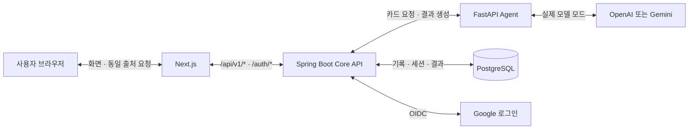
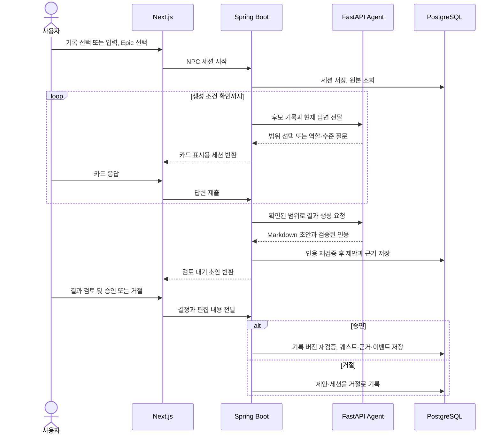

# RecallNote MVP

RecallNote는 프로젝트 경험과 학습 기록을 모아, 원본 근거를 검토할 수 있는 **경력기술서 초안**이나 **학습 로드맵**으로 만드는 웹 앱입니다. 사용자가 결과를 검토하고 승인하면 수정한 본문과 근거가 퀘스트로 저장됩니다.

## 현재 구현

| 기능 | 동작 |
| --- | --- |
| 프로필과 Epic | 목표에 따라 CAREER 또는 LEARNING Epic을 선택합니다. Epic은 결과물의 방향과 완료 기준을 담습니다. |
| 내 경험 | 기록을 직접 작성하거나 Markdown 파일과 Notion 내보내기 ZIP에서 가져옵니다. 검색, 트랙별 필터, 원본 상세 보기, 수정과 삭제를 지원합니다. 추천 트랙은 제목·본문·Notion 경로를 바탕으로 계산합니다. |
| NPC 대화 | 저장된 기록을 최대 20개 선택하거나 새 경험을 입력합니다. 여러 기록을 선택하면 이번에 사용할 범위를 고릅니다. 역할 또는 학습 수준에 답하면 초안이 생성됩니다. 진행 중인 세션은 새로고침 후 이어갈 수 있습니다. |
| 결과 검토와 퀘스트 | Markdown 초안과 원본 기록 요약, 근거 발췌를 함께 확인합니다. 결과를 편집하고 저장하면 퀘스트가 생성되며, 거절하면 제안 상태가 변경됩니다. |
| 작성 도구와 학습 화면 | 작성 스튜디오에서 저장된 퀘스트와 원본을 바탕으로 템플릿 초안을 만들고 복사하거나 Markdown으로 내려받을 수 있습니다. 학습 노트와 기억 지도에서 기록과 퀘스트를 살펴볼 수 있습니다. |
| 로그인 | 운영 환경은 Google OIDC 로그인, PostgreSQL 기반 세션, 사용자별 데이터 접근 제어를 사용합니다. |

## 아키텍처



| 구성 | 책임 | 주요 코드 |
| --- | --- | --- |
| Next.js 16 · React 19 | 보관함, NPC 카드, 검토 화면과 작성 도구를 제공합니다. 동일 출처의 API 및 인증 요청을 Spring으로 전달합니다. | [화면](frontend/src/app/page.tsx) · [요청 프록시](frontend/src/lib/upstream.ts) |
| Spring Boot 3 · Java 17 | 인증, 기록과 Epic, 세션 상태, 입력 검증, Agent 호출, 제안과 승인 트랜잭션을 담당합니다. | [Core API](backend/src/main/java/com/recallnote/core/ApiController.java) · [인증 설정](backend/src/main/java/com/recallnote/core/SecurityConfig.java) |
| FastAPI · Python 3.12 | 대화 카드 구성, 결과 제안 생성, 인용 근거와 원본 반영 범위 검증을 담당합니다. | [Agent 진입점](agent/app/main.py) |
| PostgreSQL 16 · Flyway | 원본 기록과 버전, 로그인·대화 세션, 제안, 근거, 승인 결과와 이벤트를 저장합니다. | [DB 마이그레이션](backend/src/main/resources/db/migration) |

Compose에서는 Core API가 내부 네트워크의 `http://agent-api:8000`으로 Agent를 호출합니다. 내부 요청은 `X-Internal-Api-Key`로 인증합니다. 로컬 Next.js는 별도 프로세스로 실행합니다.

## 기록에서 퀘스트까지



- **Record**는 원본 Markdown과 버전을 보관합니다. 대화에서 추가한 설명도 별도의 기록으로 저장됩니다.
- **Evidence**는 기록 ID, 버전, 원문 발췌로 구성됩니다. 한 기록 안의 서로 다른 근거 구절도 보존합니다.
- **Proposal**은 검토 대기 상태의 초안입니다. 제목, 목표, 단계, 완료 기준, 제안 이유, 결과 Markdown과 근거를 담습니다.
- **Quest**는 사용자 승인 결과입니다. Spring은 최신 기록이 근거의 버전과 일치하는지 다시 확인하고, 검토한 결과와 근거 및 생성 이벤트를 한 트랜잭션으로 저장합니다. 근거 기록이 수정·삭제되면 승인은 HTTP 409를 반환합니다. 거절한 제안에서는 퀘스트가 생성되지 않습니다.

## Agent가 하는 일

### 1. 다음 대화 카드 결정

`POST /internal/v1/agent-sessions/interpret`는 후보 기록, 보충 기록, 현재 답변을 받아 다음 카드를 규칙으로 구성합니다.

- 후보 기록이 여러 개면 명시된 `project:` 태그 또는 본문의 프로젝트명으로 묶습니다. 프로젝트 정보가 없는 기록은 개별 후보로 제시합니다. 여러 묶음이 있으면 선택한 전체 기록을 사용할 수도 있습니다.
- CAREER는 담당 역할, LEARNING은 현재 학습 수준을 묻습니다. 응답하면 초안을 생성하고 최종 검토 화면에서 사실과 근거를 확인할 수 있습니다.
- 입력할 때 선택한 원본 기록에 보충 설명을 추가할 수 있습니다.

### 2. 확인된 입력으로 초안 생성

`POST /internal/v1/quest-proposals/generate`는 선택한 기록과 보충 기록, 확인된 답변, 프로필, Epic, 기존 활성 퀘스트를 받습니다. CAREER는 본인의 역할·행동·검증 가능한 성과를 중심으로 경력기술서 초안을 만들고, LEARNING은 목표·실습·검증 기준을 포함하는 로드맵을 만듭니다.

| 모드 | 생성 방식 | 설정 |
| --- | --- | --- |
| `mock` | 고정 템플릿으로 대화와 저장 흐름을 확인합니다. Compose 기본값입니다. | 모델 키 없이 실행 |
| `openai` | OpenAI Agents SDK를 사용합니다. 모델은 요청별 스키마에 허용된 근거 ID를 선택하고, Agent가 이를 정확한 원문과 버전으로 복원합니다. 기록마다 최대 4,800자를 240자 단위로 제공하며 긴 기록은 앞뒤 2,400자를 사용합니다. | `OPENAI_API_KEY`, 선택 `OPENAI_MODEL` |
| `gemini` | Google GenAI SDK를 사용합니다. 기록별 앞 1,200자를 입력으로 전달하고 모델이 반환한 발췌를 원문과 대조합니다. | `GEMINI_API_KEY`, 선택 `GEMINI_MODEL` |

### 3. 근거 검증과 결과 반환

실제 모델 모드에서는 제안에 유효한 인용이 하나 이상 있어야 하며, 비어 있지 않은 모든 대상 기록은 유효한 인용이나 구체적인 제외 이유로 설명되어야 합니다. 제외 이유는 초안에 표시됩니다. 유효한 제안이 없으면 최대 한 번 교정을 요청합니다. 모델 생성과 교정은 총 75초 안에서 실행되며, 교정 후에도 사용할 수 있는 제안이 없으면 HTTP 422로 실패를 알립니다.

Spring은 반환된 인용이 요청 범위 내의 사용자 기록에 속하는지, 버전이 맞는지, 원문에 그대로 존재하는지 검증한 뒤 제안을 저장합니다. 검토 화면에서 사용자가 초안의 의미와 사실관계를 확인하고 승인 여부를 결정합니다. [Agent API 계약](docs/agent-quest-contract.md) · [다중 원본과 추천 트랙](docs/multi-source-tracks.md)

## 로컬 실행

Docker Desktop과 Docker Compose v2, Node.js 22 및 pnpm이 필요합니다. 저장소 루트에서 `.env`가 없으면 예제 파일을 복사하고 `POSTGRES_PASSWORD`, `DB_PASSWORD`, `INTERNAL_API_KEY`를 설정합니다. 두 DB 비밀번호는 같은 값으로 설정합니다.

```powershell
Copy-Item .env.example .env
# .env 값을 설정한 뒤 실행합니다.
docker compose up --build -d
docker compose ps
```

Core API는 `http://localhost:8080`에서 실행됩니다. 세 서비스가 정상 상태가 되면 다른 PowerShell 창에서 프런트엔드를 실행합니다.

```powershell
Set-Location frontend
pnpm install
pnpm dev
```

`http://localhost:3000`에서 **Epic 선택 → 기록 입력 또는 선택 → NPC 대화 → 결과 검토 → 승인**을 확인할 수 있습니다. 기본 로컬 프로필은 `DEV_USER_ID`로 동작합니다. 다른 Core API 주소를 사용하면 Next.js에 `API_BASE_URL`을 설정합니다. `docker compose down`으로 종료하면 PostgreSQL 데이터 볼륨은 보존됩니다. [로컬 개발 및 점검 절차](docs/local-development.md)

<details>
<summary>로컬 API로 단일 기록 흐름 확인</summary>

```sh
curl -X POST http://localhost:8080/api/v1/records -H 'Content-Type: application/json' \
  -d '{"title":"Spring authorization notes","contentMarkdown":"Reviewed access control and fixed an authorization bug.","tags":["learning"]}'
# Use the returned record id, then the returned sessionId in subsequent calls:
curl -X POST http://localhost:8080/api/v1/agent-sessions -H 'Content-Type: application/json' \
  -d '{"useCase":"CAREER","recordIds":["<record-id>"]}'
curl -X POST http://localhost:8080/api/v1/agent-sessions/<session-id>/turns \
  -H 'Content-Type: application/json' -d '{"cardId":"role","value":"debug"}'
# Review the generated result before approving it:
curl -X POST http://localhost:8080/api/v1/agent-sessions/<session-id>/approve
curl http://localhost:8080/api/v1/quests
```

</details>

## 테스트와 배포

| 범위 | 실행 | 확인 내용 |
| --- | --- | --- |
| Agent | `agent/`에서 `python -m unittest discover -s tests -v` | 기록 범위, 보충 처리, 인용 무결성과 평가 규칙 |
| 백엔드 | JDK 17로 `backend/`에서 `mvn test` | 세션과 승인, 사용자별 접근 제어, Notion 가져오기. PostgreSQL 통합 테스트는 별도 테스트 DB 설정이 필요합니다. |
| 프런트엔드 | `frontend/`에서 `pnpm test:auth`, `pnpm build` | 프록시 인증 테스트와 프로덕션 빌드 |
| 실제 모델 품질 | [결과 품질 평가 절차](docs/result-quality-evaluation.md) | 테스트 기록을 바탕으로 개인 기여, 사실의 정확성, 프로젝트 혼합 여부와 근거의 적절성을 평가합니다. |

기존 Python 통합 테스트는 헤더 인증 제거 후 비활성화되어 있습니다. 브라우저에서 전체 사용자 흐름을 확인하고, 필요한 경우 별도 테스트 DB로 PostgreSQL 통합 테스트를 실행합니다.

운영 배포에서는 Google OIDC와 세션 쿠키를 설정하고 개발용 사용자 모드를 끕니다. 모델 키는 Agent 서비스에만 설정하고, Core API와 Agent에 동일한 `INTERNAL_API_KEY`를 설정합니다. [소셜 로그인과 배포 설정](docs/social-login.md) · [Notion ZIP 형식과 처리 한도](docs/notion-import.md)
