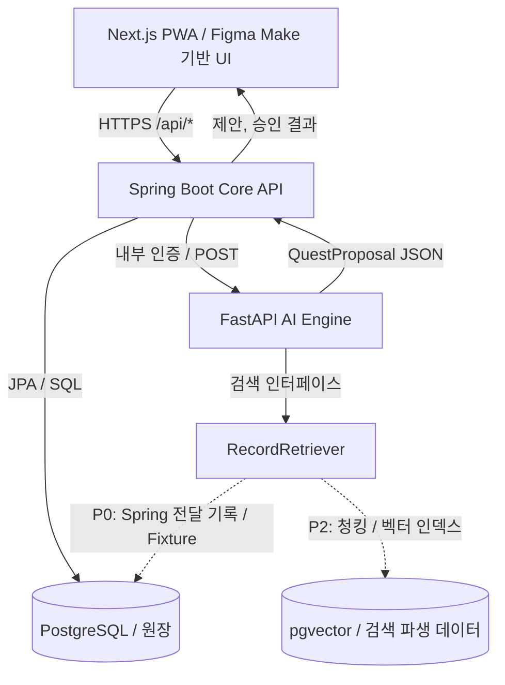

# RecallNote MVP — 신규 레포지토리 스켈레톤·API 설계 참고표

> 버전: v0.2 · 기준: 2026-10-28  
> 목적: Codex를 이용해 신규 레포지토리의 **엔드포인트 초안·프로젝트 골격·로컬 통합 실행**을 설계하고, 이후 핵심 Agent 수직 슬라이스를 구현하기 위한 기준 문서  
> 상태: **제안 설계(최종 확정 DDL/API 아님)** — 구현 전 변경할 수 있으나 서비스 간 계약은 명시적으로 관리한다.

> **현재 구현 상태 안내 (2026-10-31):** 이 문서는 초기 목표와 제안 설계를 보존한다. 아래의 P0/P1 설명이나 API 표는 현재 코드 상태를 뜻하지 않을 수 있다. 현재 동작은 이 문서의 「현재 구현 스냅샷」과 `docs/agent-quest-contract.md`를 기준으로 확인한다.

## 현재 구현 스냅샷 (2026-10-31)

### 구현됨

- 실제 저장소 구조는 모노레포의 `frontend/` (Next.js), `backend/` (Spring Boot), `agent/` (FastAPI), `docs/`, 루트 `compose.yaml`이다. Compose는 PostgreSQL·Core API·Agent를 실행하며 Next.js는 별도 개발 서버로 실행한다.
- 기록 CRUD와 활성 Epic 조회, Agent 제안 생성, 제안 목록·상세·결정, 퀘스트 조회가 Spring API에 구현되어 있다. 외부 요청은 Spring만 받고, FastAPI는 Compose 내부에서만 접근한다.
- Spring은 Agent 요청에 사용자 프로필, 활성 Epic, 최근 수정된 기록 최대 20개, 해당 Epic의 진행 중 퀘스트 최대 20개를 전달한다. 기록은 의미 검색이 아니라 최근 수정 시각 순으로 전달한다.
- 제안은 `title`, `description`, `steps` (2~5개), `completionCriteria`, `rationale`, `evidence`를 가진다. 근거는 기록 ID·버전·발췌문을 가리킨다. Spring은 소유 사용자, 삭제 여부, 버전을 검사하고 근거를 저장한다. 발췌문 텍스트와 원문 자체의 일치 여부는 검사하지 않는다.
- 사용자 화면은 제안의 목표·단계·완료 기준·근거를 보여주고 수정·수락·거절을 제공한다. 수락하면 수정된 구조가 Quest로 복사되고 근거 연결 및 생성 이벤트와 함께 트랜잭션으로 저장된다. 퀘스트 화면은 단계와 완료 기준을 표시한다.
- Flyway V2가 `quest_proposal` 및 `quest`에 `steps_json`과 `completion_criteria`를 추가한다. 기존 행은 기본값으로 보존된다.
- `AGENT_MODE=mock`은 일반적인 검증·재발 방지 계획을 반환하며 로컬 통합 흐름에 사용한다. `AGENT_MODE=openai`는 전달받은 프로필·Epic·기록·기존 퀘스트로 최대 하나의 제안을 생성하도록 Agents SDK를 호출한다.

### 아직 계획 또는 미구현

- 문서의 FastAPI 5단계 워크플로는 현재 별도 서비스/모듈로 구현되지 않았다. 현재 Agent 코드는 단일 엔드포인트 안에서 mock 또는 SDK 호출을 수행한다.
- pgvector, 의미 기반 기록 검색/랭킹, 인덱싱 API, Record 관계 자동 생성은 미구현이다.
- 퀘스트 상태 변경 및 상태 이벤트 조회 API, 사용자 프로필 조회·수정 API, 소셜 로그인·온보딩, 운영 배포는 미구현이다.
- Mock은 의미 분석을 하지 않는다. OpenAI 모드도 출력 형식과 근거 소유권을 검증할 뿐, 제안의 실질적 품질을 보증하지 않는다.

이 스냅샷과 아래 제안 설계가 충돌하면, **현재 코드와 `docs/agent-quest-contract.md`는 구현된 동작**, 이 문서의 나머지 부분은 구현 전 목표·아이디어로 해석한다.

## 0. 한 페이지 요약

**MVP 핵심 시나리오**

1. 개발용 고정 사용자(로컬 전용)에게 `개발자 경력기술서 완성` Epic 1개를 제공한다.
2. 사용자는 Markdown 텍스트로 개인 Record를 생성·조회·수정·삭제한다.
3. `연성하기`를 누르면 Next.js → Spring Boot → FastAPI 순서로 요청한다.
4. FastAPI가 5단계 워크플로(Context Builder → Record Retriever → Evidence Analyzer → Quest Planner → Proposal Validator)를 실행한다.
5. FastAPI가 **원본 Record ID를 근거로 포함한** QuestProposal 후보를 반환한다.
6. Spring Boot가 제안과 근거를 RDB에 `PENDING` 상태로 저장하고 프론트에 반환한다.
7. 사용자가 수락 / 수정 후 수락 / 거절하면 Spring Boot가 결과를 반영한다.
8. 수락 시 Quest, 근거 연결, 이벤트 이력을 **한 트랜잭션**에서 확정한다.

**이번 구현 필수(P0)**: 로컬 Docker Compose, RDB 영속화, Record CRUD, 고정 Epic, FastAPI 실행 및 SDK 출력, Spring↔FastAPI 연결, Proposal 저장, 승인·거절·이력, API 통합 테스트.  
**다음 단계(P1)**: Next.js 실제 화면 연결, 소셜 로그인·온보딩, 운영 배포, 배포 환경 E2E.  
**후순위(P2)**: pgvector 기반 Hybrid Search/Reranking 고도화, Record↔Record 자동 관계, Explore World, 자동 재계획, 멀티 Agent.

---

## 1. 아키텍처 / 책임 경계



| 컴포넌트 | 소유 책임 | 하지 않을 일 |
|---|---|---|
| Next.js | 기록 편집, Epic 확인, 연성 호출, 제안 검토·승인 UI | API 키 노출, DB 직접 쓰기 |
| Spring Boot | 사용자 식별·소유권 확인, Record/Epic/Quest/Proposal 원장, 피드백·트랜잭션, 내부 Agent 호출 | LLM 판단이나 임베딩 계산 |
| FastAPI | 입력 검증, Agent 5단계 실행, 근거 분석·제안·검증, 향후 Retrieval/인덱싱 | 권한 없는 원장 직접 변경, 사용자 승인 대행 |
| PostgreSQL | 원본 기록, 소유권, 제안, 승인 상태 및 이벤트 영속화 | 추론 결과 자체를 사실로 검증하는 역할 |
| pgvector(선택) | Record 청크/벡터의 **파생 검색 인덱스** | 원장 역할 |

**개발 시 중요 정책**
- **외부 API는 Spring Boot만 공개**하고 FastAPI는 컨테이너/호스팅 내부 통신을 기본으로 한다.
- 프론트에서 FastAPI를 직접 호출하지 않는다.
- `user_id`를 프론트가 임의 지정하여 다른 사람 데이터에 접근하도록 만들지 않는다. Spring Boot가 인증 컨텍스트를 결정한다.
- P0에서는 `DevCurrentUserProvider`를 **local 프로필에서만** 활성화한다. 외부 공개 전에 인증·인가를 반드시 적용한다.
- **기록 간 의미 관계(Record↔Record)** 는 이번 MVP의 필수가 아니다. **제안↔Record 근거 관계**는 필수다.

## 2. 레포지토리 스켈레톤 (모노레포 예시)

```text
recallnote/
├── apps/
│   ├── web/                          # Next.js PWA (Figma Make 코드 선별 이식)
│   │   ├── src/
│   │   ├── package.json
│   │   └── .env.example
│   ├── core-api/                     # Spring Boot 3.x / Java 17 (버전은 레포에서 결정)
│   │   ├── src/main/java/.../
│   │   │   ├── auth/                 # CurrentUserProvider(local → 운영 인증 교체)
│   │   │   ├── record/               # controller/service/repository/entity/dto
│   │   │   ├── epic/
│   │   │   ├── quest/
│   │   │   ├── proposal/
│   │   │   ├── agent/                # FastAPI Client + orchestration
│   │   │   └── common/               # 예외·응답·보안·설정
│   │   ├── src/main/resources/
│   │   │   ├── application.yml
│   │   │   ├── application-local.yml
│   │   │   └── db/migration/         # Flyway 버전 관리
│   │   ├── src/test/
│   │   ├── Dockerfile
│   │   └── build.gradle
│   └── agent-api/                    # FastAPI / OpenAI Agents SDK
│       ├── app/
│       │   ├── main.py
│       │   ├── api/internal_quests.py
│       │   ├── schemas/              # Pydantic 입력/출력 스키마
│       │   ├── workflows/quest_generation.py
│       │   ├── agents/quest_agent.py
│       │   ├── services/
│       │   │   ├── context_builder.py
│       │   │   ├── record_retriever.py
│       │   │   ├── evidence_analyzer.py
│       │   │   ├── quest_planner.py
│       │   │   └── proposal_validator.py
│       │   └── infrastructure/       # LLM / Retrieval adapter
│       ├── tests/
│       ├── Dockerfile
│       └── pyproject.toml
├── infra/
│   └── db/                           # 필요 시 초기 확장 / 로컬 DB 설정
├── compose.yaml
├── .env.example
├── .gitignore
├── README.md
└── docs/
    ├── api-contract.md
    ├── data-model.md
    └── adr/                          # 설계 결정 기록(선택)
```

**Figma Make 활용**: 내보낸 코드를 Next.js와 동일한 프레임워크라고 가정하지 말 것. `package.json`, 라우팅, CSS, 컴포넌트 의존성, 클라이언트 전용 동작을 확인하고 화면을 선별 이식한다. **4주차는 API 중심**, 화면 연동은 5주차.

## 3. API 엔드포인트 참고표 — 외부(Spring Boot)

> 외부 경로는 `/api/v1` 기준 제안. JSON 필드와 HTTP 상태 코드는 구현 전에 프론트·백엔드 간 일치시킨다.

| 우선 | Method | Endpoint | 요청 / 응답 핵심 | 비고 |
|---|---|---|---|---|
| P0 | `POST` | `/api/v1/records` | `{title, contentMarkdown, tags?}` → `Record` (`201`) | 소유자 서버 결정 |
| P0 | `GET` | `/api/v1/records` | `?page=&size=` → 목록 | 로컬 단일 유저 |
| P0 | `GET` | `/api/v1/records/{recordId}` | → `Record` | 소유권 검사 |
| P0 | `PUT` | `/api/v1/records/{recordId}` | 수정 → `Record` | 버전 증가, 이후 재인덱싱 |
| P0 | `DELETE` | `/api/v1/records/{recordId}` | `204` | 소프트 삭제 권장 |
| P0 | `GET` | `/api/v1/epics/active` | 고정 Epic 1개 | Seed 데이터 |
| P0 | `POST` | `/api/v1/agent/quest-proposals` | `{epicId}` → 제안 목록 | Spring → FastAPI 호출 |
| P0 | `GET` | `/api/v1/quest-proposals` | `?epicId=&status=` → 목록 | 승인 대기 화면 |
| P0 | `GET` | `/api/v1/quest-proposals/{proposalId}` | 근거 포함 상세 | 필수 근거 노출 |
| P0 | `POST` | `/api/v1/quest-proposals/{proposalId}/decisions` | `{action, editedTitle?, editedDescription?, reason?}` → 결정 결과 | 아래 규칙 참고 |
| P0 | `GET` | `/api/v1/quests` | `?epicId=` → 승인된 Quest | 갱신 화면 |
| P1 | `PATCH` | `/api/v1/quests/{questId}/status` | `{status}` → Quest | 진행/완료 추적 |
| P1 | `GET` | `/api/v1/quests/{questId}/events` | 상태 변경 이력 | 디버깅·UI |
| P1 | `GET` | `/api/v1/users/me` | 프로필 | 로그인·온보딩 때 |
| P1 | `PUT` | `/api/v1/users/me/profile` | 직업·관심사 | 인증 연결 이후 |

**결정 API 규칙**

| action | 효과 | 필수 필드 |
|---|---|---|
| `ACCEPT` | 현재 Proposal로 Quest 확정 | 없음 |
| `ACCEPT_EDITED` | 수정 내용으로 Quest 확정; 원 Proposal도 보존 | `editedTitle` 또는 `editedDescription` 중 수정 값 |
| `REJECT` | Proposal을 `REJECTED`로 변경, Quest 생성 안 함 | `reason` 선택 |

- **중복 승인 금지**: 이미 결정된 Proposal에 다른 결정 요청은 `409 Conflict`.
- **원자성**: ACCEPT/ACCEPT_EDITED는 `proposal 상태 변경 + quest 생성 + quest_evidence 생성 + quest_event 생성`을 단일 DB 트랜잭션으로 처리.
- 피드백을 바탕으로 **즉시 자동 재생성하지 않는다**(향후 확장).
- MVP는 동기식 생성 응답으로 시작할 수 있으나 타임아웃을 분명히 하고, 오래 걸리면 `202 Accepted + runId + GET status` 형태로 바꾸는 확장점을 남긴다.

## 4. API 엔드포인트 참고표 — 내부(FastAPI)

| 우선 | Method | Endpoint | 역할 | 접근 |
|---|---|---|---|---|
| P0 | `POST` | `/internal/v1/quest-proposals/generate` | 사용자 맥락·Epic·Record를 받아 Agent 워크플로 실행 | Spring Boot 내부 호출만 |
| P0 | `GET` | `/health/live` | 프로세스 응답 | 내부 |
| P0 | `GET` | `/health/ready` | 기동·설정 준비 상태 | 내부 |
| P1 | `POST` | `/internal/v1/records/index` | Record 버전 단위 비동기 인덱싱 요청 | 벡터 검색 적용 시 |

**내부 서비스 인증**: 로컬에서는 `INTERNAL_API_KEY` 헤더 검증 또는 동등한 방식으로 구현하고 외부 노출을 차단한다. 배포 환경은 프라이빗 네트워크 + 적절한 서비스 인증을 사용한다. `OPENAI_API_KEY`는 **FastAPI 서버에만** 설정.

### 4.1 Spring → FastAPI 요청 예시

```json
{
  "runId": "run-001",
  "userContext": {
    "userId": "dev-user-001",
    "occupation": "웹 개발자",
    "interests": ["Spring Boot", "AI Agent"]
  },
  "epic": {
    "id": "epic-001",
    "title": "개발자 경력기술서 완성",
    "completionCriteria": "제출 가능한 경력기술서 작성"
  },
  "records": [
    {
      "id": "record-001",
      "title": "협력사 권한 검증",
      "contentMarkdown": "# 문제 해결\n협력사 계정 권한 검증 및 오류 수정...",
      "version": 1
    }
  ],
  "existingQuests": []
}
```

> P0 Retrieval은 FastAPI가 **전달받은 Record를 대상**으로 단순 관련성 필터/선정해도 된다. 검색 인터페이스는 추후 pgvector로 교체한다. 대량 기록을 매 호출마다 FastAPI로 보내는 구조는 장기 목표가 아니다.

### 4.2 FastAPI → Spring 응답 예시

```json
{
  "runId": "run-001",
  "status": "SUCCEEDED",
  "proposals": [
    {
      "clientProposalId": "proposal-candidate-001",
      "title": "권한 검증 사례를 경력기술서로 정리",
      "description": "문제 상황, 조치 과정, 검증 결과를 정리한다.",
      "evidence": [
        {
          "recordId": "record-001",
          "recordVersion": 1,
          "excerpt": "협력사 계정 권한 검증 및 오류 수정"
        }
      ],
      "rationale": "현재 Epic에 부합하며 실제 업무 기록에 근거함"
    }
  ],
  "warnings": []
}
```

**계약 검증 조건**
- 생성된 `recordId`는 입력의 허용 Record ID 안에 있어야 한다.
- `recordVersion`과 `excerpt`는 해당 원문과 대조한다(가능하면 실제 위치/오프셋 포함).
- 출처 없는 제안은 거절하거나 재검토 대상으로 반환한다.
- 비어 있는 제안 배열 `[]`은 오류가 아니라 유효한 결과일 수 있다.
- 실행 실패·타임아웃은 성공 제안으로 위장하지 않고 명확히 오류 처리한다.
- 입력 Record 내용은 **신뢰할 수 없는 사용자 데이터**이며, 내부 시스템 지시처럼 실행하지 않는다.

## 5. FastAPI 내부 5단계 = 5개 독립 Agent가 아님

| Step | 구현 책임 | P0 구현안 | LLM |
|---|---|---|---|
| 1. Context Builder | Epic·프로필·기존 Quest를 조합 | 일반 Python 서비스 | 불필요 |
| 2. Record Retriever | 후보 기록 탐색·선별 | 입력 Record / Fixture 기반, 인터페이스 분리 | 불필요(P0) |
| 3. Evidence Analyzer | 기록에서 경험·성과·근거 추출 | Agents SDK 구조화 출력 | 사용 |
| 4. Quest Planner | 근거 기반 실행 가능한 퀘스트 생성 | Agents SDK 구조화 출력 | 사용 |
| 5. Proposal Validator | 실제 출처·중복·목표 적합성 확인 | 결정적 Python 검증 + 필요 시 보완 | 선택 |

- 초기에 `Evidence Analyzer`와 `Quest Planner`는 **한 개의 SDK Agent**로 묶어도 된다. 단계별 입력·출력과 검증 경계는 유지한다.
- 오케스트레이션은 일반 Python `async def generate_quest_proposals(...)` 함수가 제어한다.
- 승인 및 RDB 변경은 **FastAPI Agent의 직접 책임이 아니다**.

```python
async def generate_quest_proposals(request):
    context = build_context(request)
    records = await retriever.search(context, request.records)
    # 아래 둘은 하나의 SDK 호출로 합칠 수 있다.
    evidence = await analyze_evidence(context, records)
    candidates = await plan_quests(context, evidence)
    return validate_proposals(context, records, candidates)
```

**Agent 지침 최소 조건**: 사용자의 현재 Epic을 벗어나지 않기, 기록에 없는 사실/성과 추측하지 않기, 식별 가능한 근거 반환, 기존 Quest와 불필요하게 중복하지 않기, 근거 부족 시 생성하지 않기.

## 6. RDB 논리 모델 (테이블명 제안)

| 테이블 | 핵심 필드 예시 | 비고 |
|---|---|---|
| `users` | `id`, `created_at` | P0 고정 사용자 Seed |
| `user_profile` | `user_id`, `occupation`, `interests_json` | Agent Context용 임시 데이터 |
| `record` | `id`, `user_id`, `title`, `content_markdown`, `tags_json`, `version`, `deleted_at`, `created_at`, `updated_at` | Markdown 원본 Source of Truth |
| `epic` | `id`, `user_id`, `title`, `completion_criteria`, `status` | P0 한 개만 Seed |
| `agent_run` | `id`, `user_id`, `epic_id`, `status`, `error_code`, `created_at` | 실행 추적(권장 P0) |
| `quest_proposal` | `id`, `run_id`, `epic_id`, `user_id`, `title`, `description`, `status`, `decision_reason` | PENDING/ACCEPTED/REJECTED |
| `proposal_evidence` | `proposal_id`, `record_id`, `record_version`, `excerpt` | 원본 기록 참조 |
| `quest` | `id`, `user_id`, `epic_id`, `source_proposal_id`, `title`, `description`, `status` | 승인 후 생성 |
| `quest_evidence` | `quest_id`, `record_id`, `record_version` | 확정된 근거 스냅샷 연결 |
| `quest_event` | `id`, `quest_id`, `event_type`, `old_status`, `new_status`, `created_at` | 승인/진행/완료 이력 |

**P0 최소화 대안**: `agent_run`, `quest_evidence` 일부는 단순화할 수 있지만 추적성은 떨어진다. `proposal_evidence`는 생략하지 않는 것을 추천한다. `record_relation`은 P2.

**상태 전이 예시**

```text
agent_run:      RUNNING → SUCCEEDED | FAILED
quest_proposal: PENDING → ACCEPTED | REJECTED
quest:          TODO → IN_PROGRESS → DONE
```

- 하나의 제안에서 Quest는 최대 하나만 생성(유니크 제약 권장).
- 기록 변경/삭제 시 기존 제안의 근거가 사라지지 않도록 버전과 발췌문을 보존한다.
- `user_id`, `epic_id`, `record_id` 등은 FK와 소유권 검사로 보호한다.
- DB 변경은 Flyway 등으로 버전 관리; 운영에서 Hibernate `ddl-auto=create/update`에 의존하지 않는다.

## 7. 기록 저장과 벡터 인덱싱의 시점 분리

**기록 생성·수정**

```text
UI → Spring Boot → record 원본 저장(RDB)
  → [P1/P2] indexing_job 또는 outbox 생성
  → FastAPI 청킹·임베딩
  → pgvector 청크 인덱스 반영
  → 인덱싱 상태 READY/FAILED
```

**Agent 연성·승인**

```text
UI → Spring Boot(소유권 확인)
  → FastAPI(검색·분석·제안·검증)
  → Spring Boot(Proposal/Evidence 저장)
  → UI(제안 및 근거 표시)
  → 사용자가 승인 / 수정 후 승인 / 거절
  → Spring Boot(Quest/Event/관계 원장 트랜잭션)
```

- **승인했다고 그 순간 Record 벡터를 생성해야 하는 건 아니다.** 벡터 인덱스는 기록 입력/변경에 대응하는 파생 데이터.
- 이번 P0에서 **벡터 인덱스 구현은 선택**이며 조회 인터페이스만 고정한다. `pgvector`를 도입한다면 별도 DB가 아니라 동일 PostgreSQL의 검색용 스키마/테이블로 시작 가능.
- 추후 인덱싱 작업에는 `record_id + version`을 넣어 **중복 실행, 오래된 버전 완료, 삭제 데이터 재등장**을 방지한다.

## 8. Docker / 배포 환경 경계

**4주차(Local)**: 개인 Windows PC + Docker Desktop + Docker Compose. Spring Boot / FastAPI / PostgreSQL 컨테이너로 전체 API 검증; Next.js는 로컬 개발 서버 가능.  
**5주차(Deploy)**: Next.js는 Vercel 후보, Spring Boot·FastAPI는 Railway 같은 Docker 배포 플랫폼 후보, PostgreSQL은 영속 스토리지와 백업을 제공하는 관리형 DB 후보. **실제 공급자와 pgvector 지원 여부는 배포 시 검증**.

| 서비스 | 로컬 컨테이너 이름 | 컨테이너 내부 포트 | 외부 공개 |
|---|---|---:|---|
| Spring Boot | `core-api` | `8080` | 로컬 `127.0.0.1:8080`, 운영 HTTPS API |
| FastAPI | `agent-api` | `8000` | 기본 비공개 |
| PostgreSQL | `postgres` | `5432` | 기본 비공개, 로컬만 필요 시 loopback 바인딩 |
| Next.js | `web`(선택) | `3000` | 로컬 개발 / 운영 Vercel |

**컨테이너 DNS**: Spring → FastAPI는 `http://agent-api:8000`; Spring → DB는 `postgres:5432`. **브라우저에는 컨테이너 내부 주소를 보내지 않는다.**

### 환경변수 계약 예시

| 변수 | 사용 서비스 | 설명 |
|---|---|---|
| `DB_HOST`, `DB_PORT`, `DB_NAME` | Spring Boot | DB 연결 |
| `DB_USER`, `DB_PASSWORD` | Spring Boot | DB 자격증명 |
| `AGENT_BASE_URL` | Spring Boot | FastAPI 내부 URL |
| `INTERNAL_API_KEY` | Spring Boot + FastAPI | 내부 호출 인증 |
| `OPENAI_API_KEY` | FastAPI만 | SDK 모델 호출 |
| `SPRING_PROFILES_ACTIVE` | Spring Boot | `local` / 운영 등 |
| `NEXT_PUBLIC_API_BASE_URL` | Next.js | 브라우저가 접근 가능한 공개 Spring API URL |

- `.env.example`에는 **예시 값만**, 실제 `.env`/비밀번호/API 키는 Git에 커밋하지 않는다.
- Compose 서비스에는 재시작, healthcheck, DB Named Volume을 적용한다.
- FastAPI가 설정만 있고 실제로 준비되지 않은 상태에서 Spring이 호출하지 않도록 timeout/error 응답을 구현한다.
- OpenAI 키를 프론트 또는 `NEXT_PUBLIC_*`에 넣지 않는다.
- 운영 공개 전 **실제 로그인·소유권 검증·CORS 제한·HTTPS·DB 백업**을 필수 점검한다. 개발용 고정 사용자 방식으로 공개 운영하지 않는다.

## 9. API 오류 / 트랜잭션 규칙

| 상황 | 기대 결과 |
|---|---|
| Record/Epic 없음 또는 타인 소유 | `404` 또는 권한 정책에 맞는 `403` (일관된 정책) |
| FastAPI timeout | `504` 또는 서비스 오류 + 실행 실패 기록, 유령 Proposal 생성 금지 |
| Agents SDK 호출 실패 | 내부 오류 내용을 노출하지 않고 실패 상태 및 추적 ID 반환 |
| 근거 없는 Agent 제안 | 검증 실패 / 필터링, Quest로 확정 불가 |
| 같은 Proposal 중복 승인 | `409`, 중복 Quest 방지 |
| 승인 도중 DB 오류 | 전체 트랜잭션 롤백 |
| 제안 0개 | 성공 빈 목록, UI에서 재시도/추가 기록 안내 |
| Record 수정/삭제 | 추후 검색 인덱스 재처리; 기존 근거 스냅샷 유지 |

MVP에서 사용자의 Markdown 본문, 검색 결과, 모델 출력, API 오류 로그에 개인 기록이 포함될 수 있으므로 운영 로깅은 본문 전문을 피하고 필요한 ID/처리 상태 위주로 남긴다.

## 10. 테스트 데이터와 수락 기준

**테스트 Fixture**
- local 사용자 `dev-user-001`, 프로필 `웹 개발자 / 백엔드·AI Agent`.
- Epic `epic-001`: `개발자 경력기술서 완성`.
- 실제 Markdown 기록 3~5개(권한 검증, 정산 시스템 개선 등 익명화된 예시).

| 검증 | 수락 기준 |
|---|---|
| `POST /records` | PostgreSQL에 Markdown 원본 저장 및 조회됨 |
| Agent 실행 | 실제 SDK 호출 또는 명시적 테스트 Mock으로 구조화된 JSON 생성; 테스트와 실제 모드 구분 |
| Grounding | 제안 근거의 record ID/버전/발췌가 실제 입력과 일치 |
| 저장 | Proposal은 승인 전 `PENDING`이며 Quest 생성되지 않음 |
| 승인 | 정확히 1개 Quest 생성, 근거/이력 반영 |
| 수정 후 승인 | 수정된 제목/설명이 Quest에 적용되고 원 Proposal 보존 |
| 거절 | Quest 생성 안 됨, Proposal `REJECTED` |
| 재승인 | `409` 또는 동일 결과 재반환 정책 중 하나 채택; 중복 저장 없음 |
| 서비스 통신 | Compose 환경 Spring → FastAPI 내부 주소로 정상 호출 |
| 재시작 | PostgreSQL Named Volume 덕분에 저장 기록 유지 |
| 예외 | Agent 오류와 근거 불일치를 사용자에게 성공으로 표시하지 않음 |

**4주차 Done의 의미**: Next.js가 없어도 Swagger/Postman으로 `기록 생성 → 연성 → 제안 조회 → 승인 → Quest 조회`가 실제 DB를 기반으로 완료된다.  
**5주차 Done의 의미**: 해당 흐름이 실제 인증된 사용자로 브라우저에서 HTTPS 배포 URL을 통해 재현된다.

## 11. Codex 작업 순서 / 커밋 단위 제안

1. **Repository bootstrap** — Spring Boot/FastAPI 스켈레톤, Dockerfile, Compose, 환경변수 예시, health endpoints.
2. **Domain & migrations** — Record, Epic, Proposal, Evidence, Quest, Event, User/Profile 최소 스키마 및 Seed.
3. **Core API** — Record CRUD, Epic 조회, 개발 전용 CurrentUserProvider, 검증·예외 처리.
4. **Agent core** — 요청/응답 Pydantic, Retriever 인터페이스, Agents SDK 및 5단계 워크플로, 근거 검증 테스트.
5. **Integration** — Spring Agent client, 실행 API, Proposal/Evidence 저장, 타임아웃·실패 처리.
6. **Feedback** — 승인/수정 후 승인/거절, Quest/Event 원자 트랜잭션, 중복 승인 방지.
7. **E2E** — Compose 실행, API 시나리오 테스트, README 실행·중지·문제 해결 기록.
8. **5주차 준비** — Next.js 화면 이식 범위 확인, 공개 API URL/CORS/인증/배포 변수 체크.

## 12. 이번 주에 결정할 작은 쟁점 (코드 작성 전 체크)

| 결정 | 기본 추천 | 이유 |
|---|---|---|
| 첫 Retrieval | 입력 Record 기반 또는 DB 키워드 검색 | AI 가설을 먼저 검증 |
| Agent 개수 | 1개 SDK Agent + Python 5단계 오케스트레이션 | 구현/디버깅 단순화 |
| Agent 응답 | 동기 JSON, 타임아웃/실패 명시 | 첫 E2E 간결함 |
| Epic 정책 | local 개발 유저당 고정 1개 | 스코프 제어 |
| 사용자 인증 | local 고정 Provider, 운영 연결 전 외부 차단 | 개인화 계약 검증과 인증 분리 |
| Vector DB | P0 미구현 허용, 검색 인터페이스 준비 | 인프라 과확장 방지 |
| DB 스키마 관리 | Flyway | 로컬/배포 정합성 |
| 제안 검증 | 결정적 ID/버전/발췌 검증 필수 | LLM hallucination 방지 |

---

## 13. Codex에 전달할 시작 프롬프트

> 신규 RecallNote 레포지토리에서 `RecallNote_MVP_Skeleton_API_Architecture_v0.2.md`를 기준 문서로 사용해줘. 먼저 레포 구조와 현재 구현 여부를 확인하고, 문서의 **P0만** 대상으로 스켈레톤 및 API 엔드포인트 초안을 설계해줘.  
> **1차 작업은 Controller/Router, DTO/Pydantic 스키마, Service/Repository 인터페이스, DB migration 초안, Docker/Compose 및 환경변수 예시까지**이며, 엔드포인트별 입력/출력과 Spring↔FastAPI 계약을 일치시켜줘.  
> 변경을 시작하기 전에 구현 순서·생성할 파일·보류할 기능을 간단히 보고하고, 결정되지 않은 부분은 추천 기본값과 근거를 명시해줘.  
> 기존 구조를 불필요하게 재작성하지 말고, 비밀 키를 코드에 넣지 마. 개발용 고정 사용자는 local 프로필에서만 사용해줘.  
> 1차 골격 이후 2차 작업에서 `Record CRUD → Epic 조회 → Agent 실행 → Proposal 저장 → 승인/거절 → Quest DB 저장` E2E가 동작하도록 단계적으로 구현해줘.  
> 마지막에 API 표, 실제 변경 파일, 실행 명령, 테스트 결과, 남은 미구현 항목을 구분해서 보고해줘.

